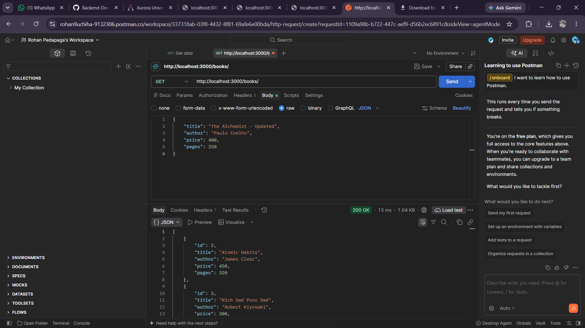
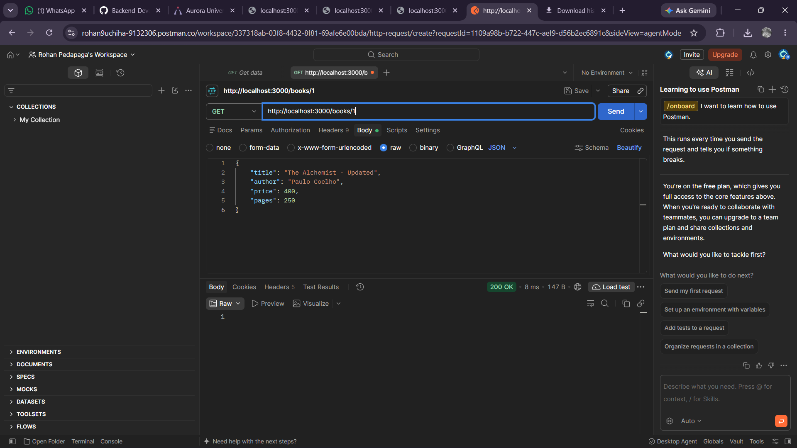
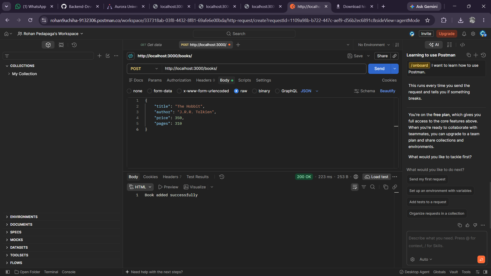
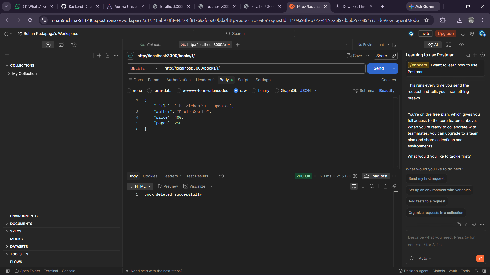
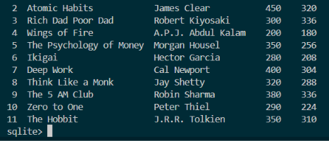
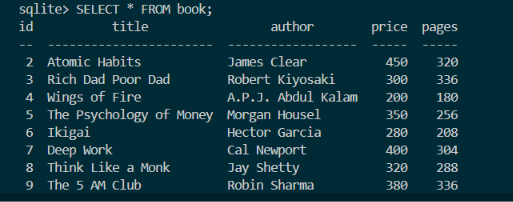

# Lab 2 - Express.js REST API with SQLite & Turso Database

## Student Information

* **Student Name:** ROHAN PEDAPAGA
* **Registration Number:** 252U1R1188
* **Section:** CSE-2D (214)
* **Course:** Backend Development Fundamentals
* **Lab:** Lab 2 - SQLite Database and Express CRUD Operations

---

## Live Deployment

* **Deployment Status:** Successfully Deployed
* **Hosting Platform:** [Vercel](https://vercel.com/)
* **Live Application URL:** https://backend-development-fundamentals-ig.vercel.app
* **Live Base API Endpoint:** https://backend-development-fundamentals-ig.vercel.app/books/

---

## 1. Lab Overview

This lab focuses on designing and implementing a persistent backend RESTful API using Node.js, Express.js, and relational database systems. The application manages a complete book inventory system supporting full Create, Read, Update, and Delete (CRUD) operations.

The architecture features a robust dual-database configuration:
* **Local Development:** Uses an embedded, file-based SQLite database (`books.db`) managed via `sqlite` and the native `sqlite3` driver.
* **Production Deployment (Vercel):** Connects seamlessly to [Turso](https://turso.tech/) (a serverless cloud database powered by LibSQL/SQLite) using `@libsql/client`. This ensures permanent data persistence in a serverless cloud environment while avoiding native C++ binary and read-only filesystem limitations on Vercel.

In both environments, SQL queries execute with parameterized values to safeguard database integrity and neutralize SQL injection vulnerabilities.

---

## 2. Objectives

The primary objectives of this lab are:
* Connect an Express.js backend server to a local SQLite database using `sqlite` and `sqlite3` for local development.
* Implement cloud database integration with Turso (LibSQL) for persistent serverless deployment on Vercel.
* Initialize a relational database schema with auto-increment primary keys and sample seed data.
* Implement complete CRUD (Create, Read, Update, Delete) routes matching RESTful conventions:
  * `GET /books/`: Retrieve all records from the database.
  * `GET /books/:bookId/`: Query a specific record by primary key using URL route parameters.
  * `POST /books/`: Parse JSON request bodies to insert new records into the database.
  * `PUT /books/:bookId/`: Modify and update existing database records by identifier.
  * `DELETE /books/:bookId/`: Remove specific records from the persistent store.
* Utilize asynchronous JavaScript (`async`/`await`) to manage non-blocking database queries smoothly.
* Implement parameterized SQL queries (`?` placeholders) to prevent SQL injection attacks.
* Configure environment variables for secure database authentication in production.
* Test and validate all HTTP endpoints and request methods using Postman and the live Vercel deployment.

---

## 3. Technologies Used

The project utilizes the following technologies and exact dependency versions as declared in `package.json`:

* **Runtime Environment:** [Node.js](https://nodejs.org/) (v18+ recommended)
* **Web Framework:** [Express.js](https://expressjs.com/) (`^5.3.0` declared in `dependencies`)
* **Cloud Database Client:** [`@libsql/client`](https://www.npmjs.com/package/@libsql/client) (`^0.18.0`): Pure JavaScript client for connecting to Turso cloud database over HTTP
* **Local Database Driver & Wrapper:**
  * [`sqlite3`](https://www.npmjs.com/package/sqlite3) (`^6.0.1`): Core asynchronous C++ SQLite driver for local Node.js execution
  * [`sqlite`](https://www.npmjs.com/package/sqlite) (`^5.1.1`): Promise-based abstraction wrapper over `sqlite3` enabling clean `async`/`await` syntax
* **Development Tool:** [Nodemon](https://nodemon.io/) (`^3.1.14` declared in `devDependencies`) for automated server restarts during development
* **Hosting Platform:** [Vercel](https://vercel.com/) (Serverless Node.js execution)
* **Cloud Database Provider:** [Turso](https://turso.tech/) (Managed distributed SQLite)
* **Module System:** CommonJS (`require` / `module.exports`)
* **Protocol & Architecture:** HTTP/1.1 RESTful API
* **API Testing Tool:** Postman

---

## 4. Project Structure

```text
lab-02/
├── node_modules/                 # External npm packages and dependencies (gitignored)
├── screenshots/                  # Output and verification screenshots
│   ├── delete.png.png            # Screenshot of DELETE /books/:bookId/ operation in Postman
│   ├── get.png.png               # Screenshot of GET /books/ (All books) in Postman
│   ├── get_by_id.png.png         # Screenshot of GET /books/:bookId/ operation in Postman
│   ├── post.png.png              # Screenshot of POST /books/ (Add new book) in Postman
│   ├── put.png.png               # Screenshot of PUT /books/:bookId/ (Update book) in Postman
│   ├── sqlite-verification.png   # Screenshot of SQLite CLI database verification (persisted records)
│   ├── sqlite_verification_1.png # Screenshot of SQLite CLI query execution and initial record rows
│   └── sqlite_verification_2.png # Screenshot of SQLite CLI scrolled terminal view showing all records
├── books.db                      # Local SQLite database binary storage file
├── database.sql                  # SQL schema definition and seed data
├── index.js                      # Express.js server, dual-mode DB initialization, and CRUD routes
├── package-lock.json             # Exact dependency lockfile for reproducible builds
├── package.json                  # Project manifest, scripts, and dependencies
└── README.md                     # Lab documentation and student report
```

---

## 5. Prerequisites

Before running this project locally, ensure you have the following installed:

* **Node.js**: Version 18.0.0 or higher. Verify installation by running:
  ```bash
  node -v
  ```
* **npm (Node Package Manager)**: Bundled with Node.js. Verify installation by running:
  ```bash
  npm -v
  ```
* **API Client**: [Postman](https://www.postman.com/) or an equivalent tool (such as cURL or Thunder Client) to test GET, POST, PUT, and DELETE HTTP requests.

---

## 6. Installation Instructions

Follow these step-by-step instructions to set up the project locally:

1. Open your terminal or command prompt and navigate to the `lab-02` directory:
   ```bash
   cd lab-02
   ```

2. Install project dependencies:
   Run the following command to install Express, Turso client, SQLite wrapper, and Nodemon as specified in `package.json`:
   ```bash
   npm install
   ```
   This downloads and configures all required dependencies into the `node_modules/` directory.

---

## 7. Database Configuration and Schema

The application schema definition and initial seed records are documented in `database.sql`:

```sql
CREATE TABLE IF NOT EXISTS book (
    id INTEGER PRIMARY KEY AUTOINCREMENT,
    title TEXT,
    author TEXT,
    price INTEGER,
    pages INTEGER
);

INSERT INTO book (title, author, price, pages) VALUES
('The Alchemist', 'Paulo Coelho', 250, 208),
('Atomic Habits', 'James Clear', 450, 320),
('Rich Dad Poor Dad', 'Robert Kiyosaki', 300, 336),
('Wings of Fire', 'A.P.J. Abdul Kalam', 200, 180),
('The Psychology of Money', 'Morgan Housel', 350, 256),
('Ikigai', 'Hector Garcia', 280, 208),
('Deep Work', 'Cal Newport', 400, 304),
('Think Like a Monk', 'Jay Shetty', 320, 288),
('The 5 AM Club', 'Robin Sharma', 380, 336),
('Zero to One', 'Peter Thiel', 290, 224);
```

### Schema Attributes:
* `id`: Unique identifier, set as `INTEGER PRIMARY KEY AUTOINCREMENT`.
* `title`: Title of the book (`TEXT`).
* `author`: Author of the book (`TEXT`).
* `price`: Retail price of the book in INR (`INTEGER`).
* `pages`: Total page count (`INTEGER`).

### Database Environments:
* **Local Development:** When `TURSO_DATABASE_URL` is not set, `index.js` automatically connects to the local `books.db` file using `sqlite3`.
* **Production on Vercel:** When `TURSO_DATABASE_URL` and `TURSO_AUTH_TOKEN` are present, `index.js` initializes the Turso cloud database client, creates the `book` table if it does not exist, and populates the seed data if the table is empty.

---

## 8. How to Run the Server Locally

The application server can be started in standard production mode or in development mode.

### Option A: Standard Execution
```bash
npm start
```
*(Alternatively: `node index.js`)*

### Option B: Development Mode (Auto-Reloading via Nodemon)
```bash
npm run dev
```

### Expected Local Console Output
Upon successful initialization of the local SQLite database and the Express server, the terminal displays:
```text
SQLite database connected successfully
Server running at http://localhost:3000
```

To terminate the server, press `Ctrl + C` in your terminal.

---

## 9. API Endpoint Documentation

The Express application implements a complete RESTful CRUD API on the `/books` resource:

### Summary Table

| HTTP Method | Endpoint Path | Description | Expected Status |
| :--- | :--- | :--- | :--- |
| **GET** | `/books/` | Retrieves all books stored in the database | `200 OK` |
| **GET** | `/books/:bookId/` | Retrieves a specific book by its ID | `200 OK` / `404 Not Found` |
| **POST** | `/books/` | Adds a new book to the database | `200 OK` |
| **PUT** | `/books/:bookId/` | Updates an existing book's details by ID | `200 OK` / `404 Not Found` |
| **DELETE** | `/books/:bookId/` | Deletes a book record from the database by ID | `200 OK` / `404 Not Found` |

---

### Detailed Endpoint Specifications

#### 1. GET /books/ (Retrieve All Books)
* **Description:** Queries the database and returns the full collection of books.
* **HTTP Method:** `GET`
* **Local URL:** `http://localhost:3000/books/`
* **Live URL:** `https://backend-development-fundamentals-ig.vercel.app/books/`
* **SQL Query Executed:**
  ```sql
  SELECT * FROM book;
  ```
* **Response Status:** `200 OK`
* **Sample Response Body:**
  ```json
  [
    {
      "id": 2,
      "title": "Atomic Habits",
      "author": "James Clear",
      "price": 450,
      "pages": 320
    },
    {
      "id": 3,
      "title": "Rich Dad Poor Dad",
      "author": "Robert Kiyosaki",
      "price": 300,
      "pages": 336
    }
  ]
  ```

#### 2. GET /books/:bookId/ (Retrieve Book by ID)
* **Description:** Queries a single book by its unique primary key `id`.
* **HTTP Method:** `GET`
* **Local URL:** `http://localhost:3000/books/:bookId/` (e.g., `http://localhost:3000/books/2/`)
* **Live URL:** `https://backend-development-fundamentals-ig.vercel.app/books/2/`
* **URL Parameters:** `bookId` (integer) - the primary key of the book.
* **SQL Query Executed:**
  ```sql
  SELECT * FROM book WHERE id = ?;
  ```
* **Response Status:** `200 OK` (or `404 Not Found` if the record does not exist)
* **Sample Response Body (200 OK):**
  ```json
  {
    "id": 2,
    "title": "Atomic Habits",
    "author": "James Clear",
    "price": 450,
    "pages": 320
  }
  ```

#### 3. POST /books/ (Create a New Book)
* **Description:** Inserts a newly provided book into the database with values parsed from the JSON body.
* **HTTP Method:** `POST`
* **Local URL:** `http://localhost:3000/books/`
* **Live URL:** `https://backend-development-fundamentals-ig.vercel.app/books/`
* **Request Headers:** `Content-Type: application/json`
* **Request Body:**
  ```json
  {
    "title": "The Hobbit",
    "author": "J.R.R. Tolkien",
    "price": 350,
    "pages": 310
  }
  ```
* **SQL Query Executed:**
  ```sql
  INSERT INTO book (title, author, price, pages)
  VALUES (?, ?, ?, ?);
  ```
* **Response Status:** `200 OK`
* **Response Body:**
  ```text
  Book added successfully
  ```

#### 4. PUT /books/:bookId/ (Update an Existing Book)
* **Description:** Updates attributes (`title`, `author`, `price`, `pages`) of a target book matching `bookId`.
* **HTTP Method:** `PUT`
* **Local URL:** `http://localhost:3000/books/:bookId/` (e.g., `http://localhost:3000/books/1/`)
* **Live URL:** `https://backend-development-fundamentals-ig.vercel.app/books/1/`
* **URL Parameters:** `bookId` (integer) - target book ID.
* **Request Headers:** `Content-Type: application/json`
* **Request Body:**
  ```json
  {
    "title": "The Alchemist - Updated",
    "author": "Paulo Coelho",
    "price": 400,
    "pages": 250
  }
  ```
* **SQL Query Executed:**
  ```sql
  UPDATE book
  SET title = ?, author = ?, price = ?, pages = ?
  WHERE id = ?;
  ```
* **Response Status:** `200 OK` (or `404 Not Found` if book ID does not exist)
* **Response Body:**
  ```text
  Book updated successfully
  ```

#### 5. DELETE /books/:bookId/ (Delete a Book)
* **Description:** Deletes a specific book from the database table matching `bookId`.
* **HTTP Method:** `DELETE`
* **Local URL:** `http://localhost:3000/books/:bookId/` (e.g., `http://localhost:3000/books/1/`)
* **Live URL:** `https://backend-development-fundamentals-ig.vercel.app/books/1/`
* **URL Parameters:** `bookId` (integer) - target book ID to delete.
* **SQL Query Executed:**
  ```sql
  DELETE FROM book WHERE id = ?;
  ```
* **Response Status:** `200 OK` (or `404 Not Found` if book ID does not exist)
* **Response Body:**
  ```text
  Book deleted successfully
  ```

---

## 10. Explanation of package.json and Dependencies

The project dependencies are declared in `package.json`:

```json
{
  "name": "lab-02",
  "version": "1.0.0",
  "description": "",
  "main": "index.js",
  "scripts": {
    "start": "node index.js",
    "dev": "nodemon index.js"
  },
  "dependencies": {
    "@libsql/client": "^0.18.0",
    "express": "^5.3.0",
    "sqlite": "^5.1.1",
    "sqlite3": "^6.0.1"
  },
  "devDependencies": {
    "nodemon": "^3.1.14"
  }
}
```

### Dependency Roles:
* **`express` (`^5.3.0`)**: The core web framework providing route dispatching, JSON middleware (`express.json()`), and HTTP lifecycle management.
* **`@libsql/client` (`^0.18.0`)**: Lightweight, pure JavaScript HTTP client used for connecting to Turso cloud database on Vercel. It requires no native C++ compilation, completely bypassing native GLIBC constraints on serverless platforms.
* **`sqlite3` (`^6.0.1`)**: Native asynchronous SQLite driver used for local execution on Windows/macOS/Linux.
* **`sqlite` (`^5.1.1`)**: Promise-based client wrapper around `sqlite3` for clean `async`/`await` syntax during local development.
* **`nodemon` (`^3.1.14`)**: Developer convenience tool for automatic server restarts upon file changes.

---

## 11. Database Operations & Dual-Mode Architecture

In `index.js`, the application implements an adaptive dual-mode database layer:

```javascript
const initializeDB = async () => {
    if (process.env.TURSO_DATABASE_URL && process.env.TURSO_AUTH_TOKEN) {
        // TURSO DATABASE (VERCEL PRODUCTION)
        turso = createClient({
            url: process.env.TURSO_DATABASE_URL,
            authToken: process.env.TURSO_AUTH_TOKEN
        });
        // Auto-creates schema and seeds initial data if table is empty
        ...
        console.log("Turso database connected successfully");
    } else {
        // LOCAL SQLITE DATABASE (DEVELOPMENT)
        const sqlite3 = require("sqlite3");
        const { open } = require("sqlite");

        db = await open({
            filename: path.join(__dirname, "books.db"),
            driver: sqlite3.Database
        });
        console.log("SQLite database connected successfully");
    }
};
```

### Key Architectural Benefits:
1. **Preserves Assignment Requirements:** Retains the exact local SQLite database (`books.db`) workflow with zero changes to local assignment execution.
2. **True Cloud Persistence:** Resolves the serverless ephemeral/read-only filesystem limitation on Vercel by utilizing Turso's cloud database over HTTP.
3. **Parameterized Queries:** Both drivers strictly execute queries using parameterized arguments (`?` placeholders) to prevent SQL injection vulnerabilities across both local SQLite and remote Turso engines.
4. **Serverless Middleware Check:** Custom `ensureDatabase()` middleware verifies connection readiness on incoming requests, preventing cold-start race conditions.

---

## 12. Environment Variables

To connect the application to the Turso cloud database when deployed on Vercel, the following environment variables are required:

| Environment Variable | Description | Location / Scope |
| :--- | :--- | :--- |
| `TURSO_DATABASE_URL` | The secure connection URL endpoint for the remote Turso database instance (e.g., `libsql://<database-name>-<org>.turso.io`) | Vercel Project Environment Variables |
| `TURSO_AUTH_TOKEN` | The secret bearer authentication token issued by Turso to authorize database read and write transactions | Vercel Project Environment Variables |

> [!IMPORTANT]
> **Security Notice:** Actual database connection URLs and secret authentication tokens are confidential credentials and must **never** be hardcoded in source code or committed to public Git repositories. They are securely injected into the runtime environment via the Vercel Dashboard under **Project Settings &rarr; Environment Variables**.
>
> In local development, if these variables are omitted, the application automatically defaults to using the local SQLite database (`books.db`).

---

## 13. Screenshots

All screenshots from the Postman API test runs and SQLite database verification are embedded below using exact relative paths pointing to the existing files in the `screenshots/` directory.

### 1. GET All Books (`GET /books/`)
Retrieving the complete list of books from the database via Postman:



*Caption: Postman GET request to `http://localhost:3000/books/` returning HTTP 200 OK with the array of book objects from the database.*

---

### 2. GET Book by ID (`GET /books/:bookId/`)
Querying a specific book using the route parameter `bookId` in Postman:



*Caption: Postman GET request to `http://localhost:3000/books/1` returning HTTP 200 OK for the target book record.*

---

### 3. POST a New Book (`POST /books/`)
Adding a new book record ("The Hobbit") by sending a JSON payload in the request body:



*Caption: Postman POST request to `http://localhost:3000/books/` with JSON body returning HTTP 200 OK and "Book added successfully".*

---

### 4. PUT / Update a Book (`PUT /books/:bookId/`)
Updating an existing book's details by primary key identifier:


*Caption: Postman PUT request to `http://localhost:3000/books/1/` with updated details returning HTTP 200 OK and "Book updated successfully".*

---

### 5. DELETE a Book (`DELETE /books/:bookId/`)
Removing a specific book record from the database table:



*Caption: Postman DELETE request to `http://localhost:3000/books/1/` returning HTTP 200 OK and "Book deleted successfully".*

---

### 6. SQLite Database Verification

The following screenshots capture direct verification of the persistent database state inside the SQLite CLI:

#### Verification Overview


*Caption: Direct SQLite CLI inspection confirming persistent database records after running CRUD operations (demonstrating the deletion of ID 1 and the successful insertion of ID 11 "The Hobbit").*

#### Query Execution & Top Rows (Verification Part 1)


*Caption: SQLite CLI terminal executing `SELECT * FROM book;` displaying column headers (`id`, `title`, `author`, `price`, `pages`) and initial rows (IDs 2 through 9), confirming that record ID 1 was deleted.*

#### Terminal View & CRUD Persistence (Verification Part 2)


*Caption: Scrolled terminal view in the SQLite CLI displaying all remaining book records down to ID 11 ("The Hobbit" by J.R.R. Tolkien), verifying that the new book from the POST request was persisted.*

---

## 14. Deployment

The Express REST API application has been successfully deployed to production using Vercel.

* **Deployment Status:** Successfully Deployed
* **Hosting Platform:** Vercel (Serverless Function Architecture)
* **Live Application URL:** https://backend-development-fundamentals-ig.vercel.app
* **Database Provider:** Turso (Managed LibSQL / Cloud SQLite)
* **Production Entry Point:** `index.js` (`module.exports = app`)

### Available Live Endpoints

| HTTP Method | Live Endpoint URL | Description |
| :--- | :--- | :--- |
| **GET** | `https://backend-development-fundamentals-ig.vercel.app/books/` | Retrieves all persistent book records from Turso cloud database |
| **GET** | `https://backend-development-fundamentals-ig.vercel.app/books/:bookId/` | Retrieves a specific book record by its primary key ID |
| **POST** | `https://backend-development-fundamentals-ig.vercel.app/books/` | Creates and inserts a new book record into the cloud database |
| **PUT** | `https://backend-development-fundamentals-ig.vercel.app/books/:bookId/` | Updates an existing book record's details by ID |
| **DELETE** | `https://backend-development-fundamentals-ig.vercel.app/books/:bookId/` | Deletes a book record from the database by ID |

---

## 15. Learning Outcomes

Through completing this lab, the following core backend and database development competencies were acquired:

1. **Relational Database Design & Operations:**
   * Structured a relational SQLite database schema with auto-increment primary keys and typed columns.
   * Mastered full CRUD implementation across all four standard REST HTTP methods (`GET`, `POST`, `PUT`, `DELETE`).

2. **Security & Parameterized Queries:**
   * Applied parameterized queries using `?` placeholders with `db.all()`, `db.get()`, `db.run()`, and Turso's `execute()` method.
   * Understood how parameterized execution prevents SQL injection attacks by strictly binding user inputs as data rather than executable code.

3. **Dual-Mode Local & Cloud Database Architecture:**
   * Resolved serverless filesystem limitations (read-only bundle and ephemeral storage) by integrating Turso cloud database via `@libsql/client`.
   * Maintained seamless local development with embedded SQLite while achieving true data persistence in cloud serverless deployments.

4. **Production Serverless Deployment:**
   * Exported Express application instances for serverless function environments on Vercel.
   * Managed environment variables (`TURSO_DATABASE_URL`, `TURSO_AUTH_TOKEN`) securely without exposing secrets in version control.
