# Lab 3: REST API, Query Parameters, Validation and Debugging

## Student Information

* **Name:** ROHAN PEDAPAGA
* **Registration Number:** 252U1R1188
* **Section:** CSE-2D (214)
* **Course:** Backend Development Fundamentals
* **Lab:** 03

## Objective

The objective of this lab is to develop a REST API using Node.js, Express.js and SQLite. The API supports CRUD operations, searching, sorting, pagination, price filtering, input validation and appropriate HTTP status codes.

## Technologies Used

* Node.js
* Express.js
* SQLite
* SQLite3
* Postman
* JavaScript

## Project Structure

```text
lab-03/
│
├── index.js
├── package.json
├── package-lock.json
├── books.db
├── README.md
└── screenshots/
    ├── search.png
    ├── sort_asc.png
    ├── sort_desc.png
    ├── pagination.png
    ├── price_filter.png
    ├── post_missing_title.png
    ├── post_missing_author.png
    ├── post_invalid_price.png
    ├── post.png
    ├── put.png
    ├── delete.png
    ├── not_found.png
    ├── invalid_sort.png
    ├── invalid_limit.png
    └── get_all.png
```

## Installation and Setup

1. Navigate to the project directory.

```bash
cd lab-03
```

2. Install dependencies.

```bash
npm install
```

3. Start the development server.

```bash
npm run dev
```

4. The server runs at:

```text
http://localhost:3000
```

## API Endpoints

| HTTP Method | Endpoint         | Description             |
| ----------- | ---------------- | ----------------------- |
| GET         | `/books`         | Retrieve all books      |
| GET         | `/books/:bookId` | Retrieve a book by ID   |
| POST        | `/books`         | Add a new book          |
| PUT         | `/books/:bookId` | Update an existing book |
| DELETE      | `/books/:bookId` | Delete a book           |

## Query Parameters

The GET `/books` endpoint supports the following parameters:

| Parameter   | Description                   | Default     |
| ----------- | ----------------------------- | ----------- |
| `search_q`  | Search books by partial title | Empty       |
| `order_by`  | Column used for sorting       | `id`        |
| `order`     | Sorting direction (ASC/DESC)  | `ASC`       |
| `limit`     | Maximum number of records     | `10`        |
| `offset`    | Number of records to skip     | `0`         |
| `min_price` | Minimum book price            | Not applied |
| `max_price` | Maximum book price            | Not applied |

### Example Requests

**Search:**

```text
GET /books?search_q=atomic
```

**Ascending sorting:**

```text
GET /books?order_by=price&order=ASC
```

**Descending sorting:**

```text
GET /books?order_by=price&order=DESC
```

**Pagination:**

```text
GET /books?limit=3&offset=0
```

**Price filtering:**

```text
GET /books?min_price=100&max_price=500
```

## Input Validation

The API validates incoming POST and PUT requests.

* Title cannot be empty.
* Author cannot be empty.
* Price must be a valid non-negative number.
* Pages, when supplied, must be a non-negative integer.
* Invalid input returns HTTP `400 Bad Request`.

SQL queries use parameterized statements to prevent SQL injection. Sorting columns and directions are checked against allowed values.

## HTTP Status Codes

| Status Code | Meaning               | Usage                             |
| ----------- | --------------------- | --------------------------------- |
| 200         | OK                    | Successful GET, PUT and DELETE    |
| 201         | Created               | Successful POST                   |
| 400         | Bad Request           | Invalid input or query parameters |
| 404         | Not Found             | Requested book does not exist     |
| 500         | Internal Server Error | Unexpected server error           |

## Postman Testing

The following test cases were performed:

| Test Case                   | Expected Status | Result |
| --------------------------- | --------------- | ------ |
| Retrieve all books          | 200             | Passed |
| Search by title             | 200             | Passed |
| Sort by price ASC           | 200             | Passed |
| Sort by price DESC          | 200             | Passed |
| Pagination                  | 200             | Passed |
| Price range filtering       | 200             | Passed |
| POST with missing title     | 400             | Passed |
| POST with missing author    | 400             | Passed |
| POST with non-numeric price | 400             | Passed |
| Add a new book              | 201             | Passed |
| Update an existing book     | 200             | Passed |
| Delete an existing book     | 200             | Passed |
| Retrieve a deleted book     | 404             | Passed |
| Invalid sorting column      | 400             | Passed |
| Invalid pagination limit    | 400             | Passed |

## Debugging Exercise

### 1. Port Conflict (EADDRINUSE)

This error occurs when another process is already using the requested port.

**Solution:** Stop the previously running server or configure the application to use another available port.

### 2. Incorrect Import Path

An incorrect file path in a `require()` statement can prevent Node.js from loading a module.

**Solution:** Check the file location and correct the relative import path.

### 3. Table Name Error

The SQLite error `no such table` occurs when a query references a table that does not exist or uses an incorrect table name.

**Solution:** Verify the database file, table name and SQL statement.

### 4. Missing Await

When an asynchronous database operation is not awaited, the application may continue before the operation finishes.

**Solution:** Use `await` with asynchronous database operations inside async functions.

## Conclusion

## Postman Testing Screenshots

### GET and Search

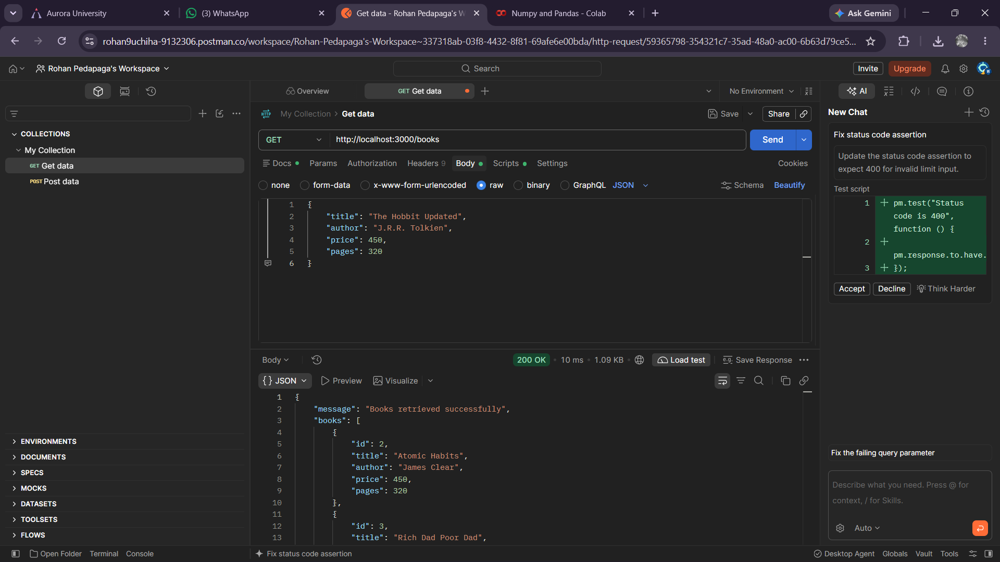

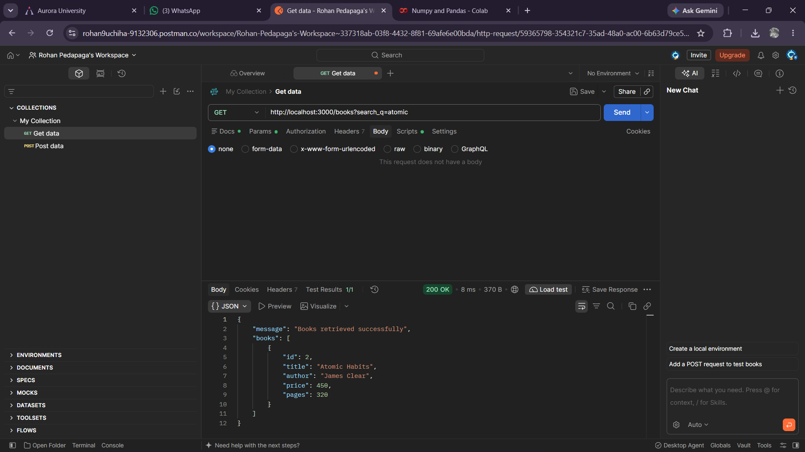

### Sorting

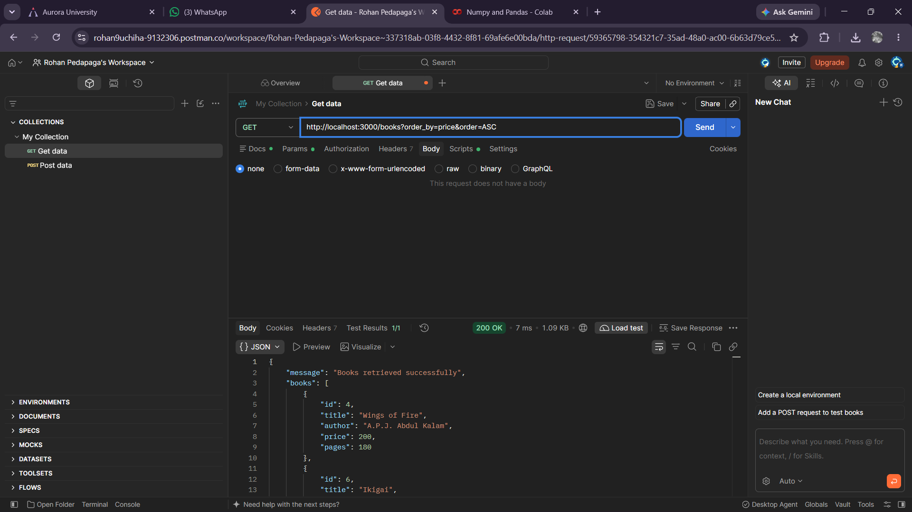

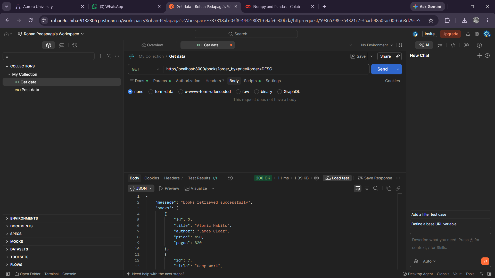

### Pagination and Price Filtering

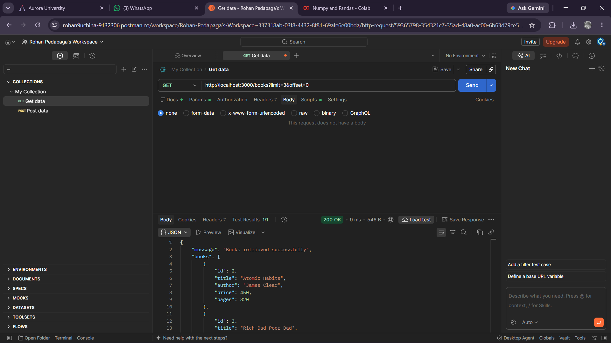

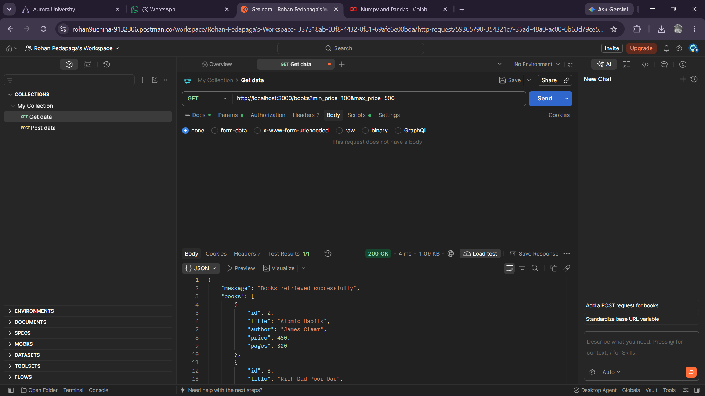

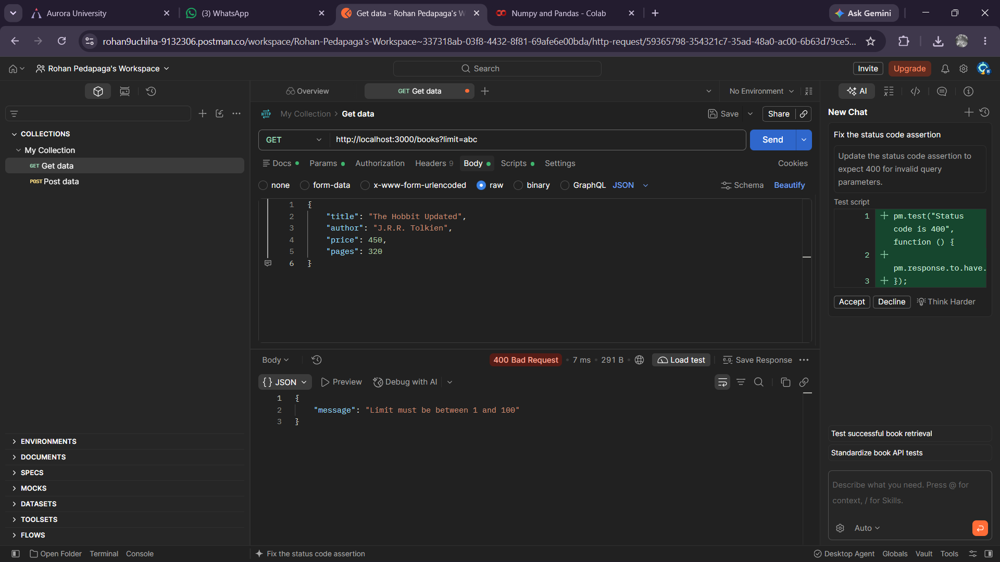

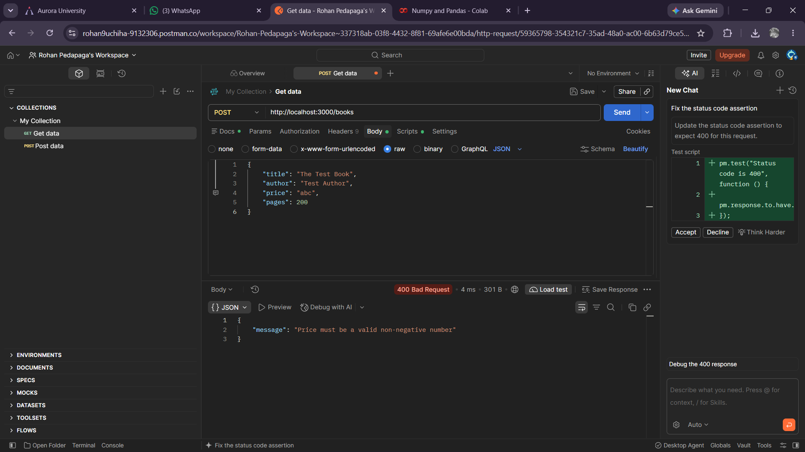

### Input Validation

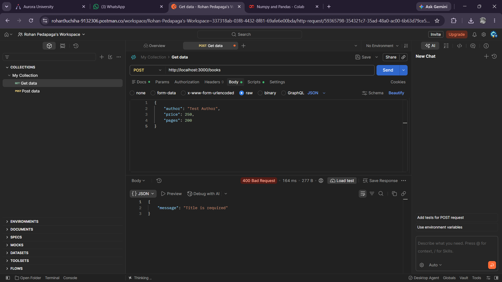

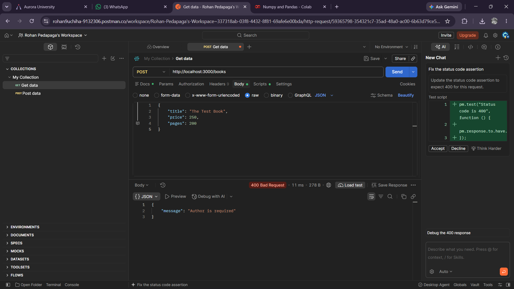

### POST, PUT and DELETE

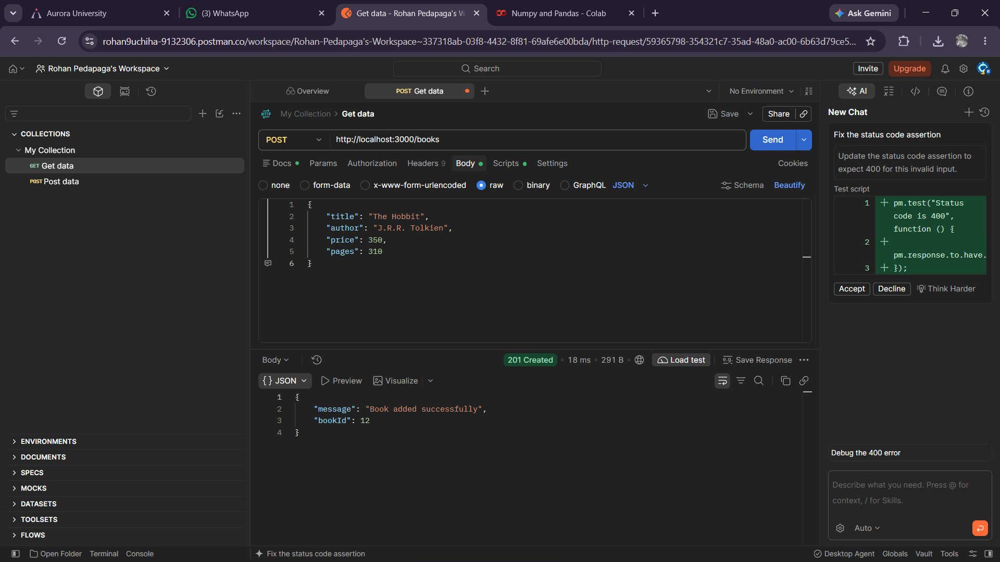


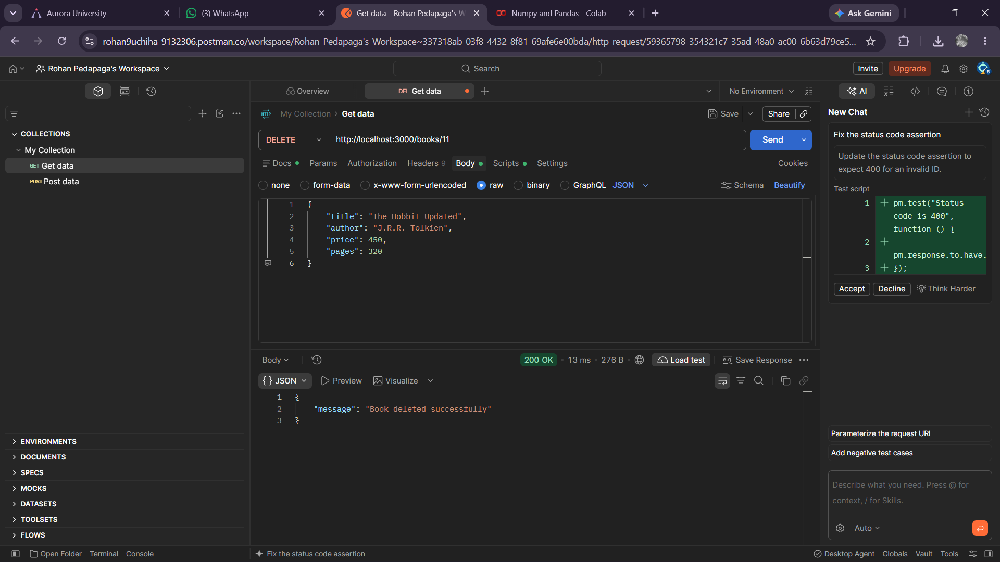

### Error Handling

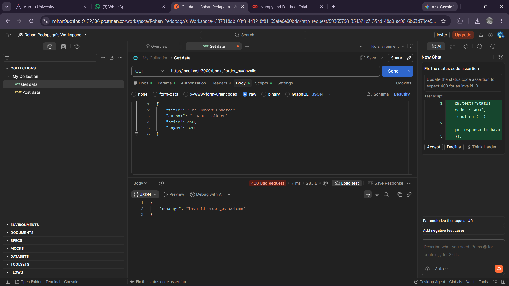


This lab helped implement a REST API with Express.js and SQLite. The application supports CRUD operations, search, sorting, pagination and price filtering. Input validation and appropriate HTTP status codes were also implemented and tested using Postman.

## Deployment

The REST API is deployed on Vercel and uses Turso as its cloud database.

- **Live API:** https://lab-03-books-api.vercel.app
- **Database:** Turso (LibSQL)
- **Hosting:** Vercel
- **Environment Variables:**
  - `TURSO_DATABASE_URL`
  - `TURSO_AUTH_TOKEN`

### Deployment Verification

The deployed API was tested successfully.

- GET `/books` returns all stored books.
- Data is retrieved from the Turso cloud database.
- The API returns a successful JSON response.