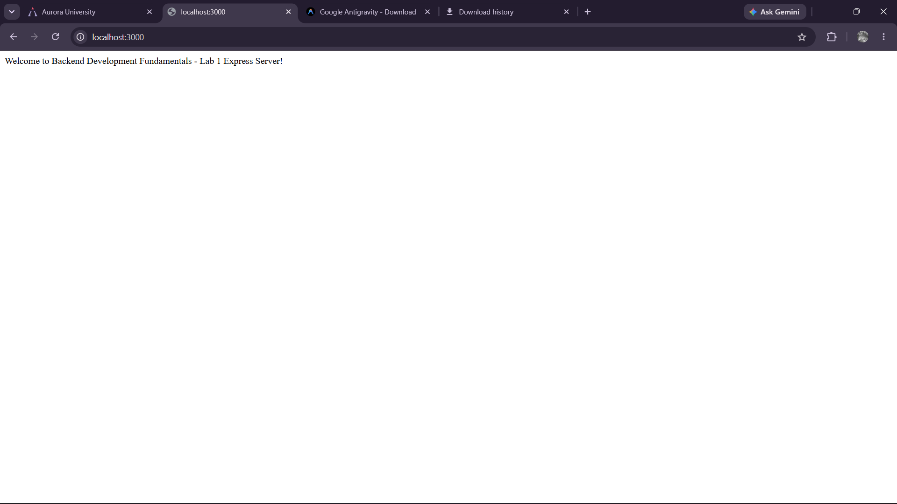
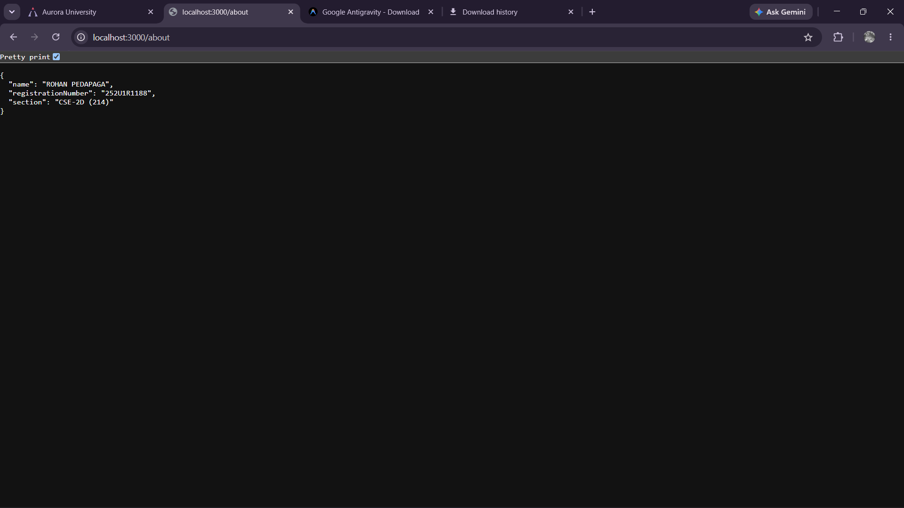
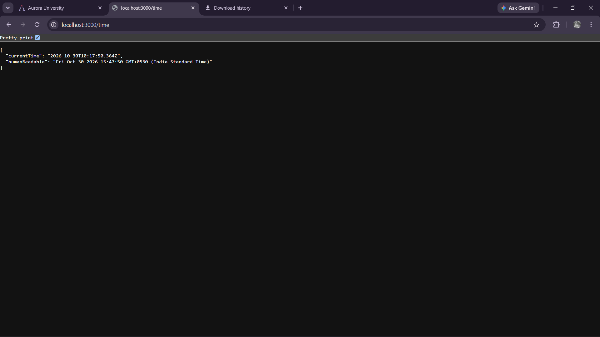

# Lab 1

## Student Information

* **Student Name:** ROHAN PEDAPAGA
* **Registration Number:** 252U1R1188
* **Section:** CSE-2D (214)
* **Course:** Backend Development Fundamentals
* **Lab:** Lab 1 - Node.js and Express Server

---

## 1. Lab Overview

This lab serves as an introduction to backend development using JavaScript in the Node.js runtime environment. The primary focus is to understand how web servers function at both a low level and a framework-assisted level.

The project demonstrates two different approaches to building an HTTP server:
1. **Low-Level Native Node.js Server (`plain-server.js`):** Built using Node's standard built-in `http` module without any third-party libraries. This illustrates fundamental networking principles, request-response lifecycles, and stream handling.
2. **Framework-Based Express.js Server (`index.js`):** Built using the Express.js web framework. This demonstrates structured route definitions, automated JSON serialization, clean middleware pipelining, and centralized 404 error handling.

---

## 2. Objectives

The core objectives of this lab are:
* Understand the client-server architecture and HTTP request/response transaction model.
* Create and run a minimal HTTP server using Node's built-in `http` module.
* Install and configure external dependencies using the Node Package Manager (`npm`).
* Initialize an Express.js application and establish modular routing.
* Return diverse content types, including plain text and structured JSON payloads.
* Generate dynamic server-side responses using JavaScript built-in utilities (e.g., `Date`).
* Implement custom catch-all middleware to handle undefined routes and return standardized HTTP 404 responses.
* Understand environment variable configuration for dynamic port binding in cloud and production environments.

---

## 3. Technologies Used

The project utilizes the following technologies and exact dependency versions as declared in `package.json`:

* **Runtime Environment:** [Node.js](https://nodejs.org/) (v18+ recommended)
* **Web Framework:** [Express.js](https://expressjs.com/) (`^5.3.0` declared in `dependencies`)
* **Development Tool:** [Nodemon](https://nodemon.io/) (`^3.1.14` declared in `devDependencies`) for automated server restarts during development
* **Module System:** CommonJS (`require` / `module.exports`)
* **Protocol:** HTTP/1.1 (RESTful GET operations)

---

## 4. Project Structure

```text
lab-01/
├── node_modules/           # External npm packages and dependencies (gitignored)
├── screenshots/            # Output and verification screenshots
│   ├── about.png.png       # Screenshot of GET /about JSON response
│   ├── home.png.png        # Screenshot of GET / welcome text response
│   ├── not found.png.png   # Screenshot of GET /random 404 handler
│   ├── plain server hello.png.png # Screenshot of native Node.js HTTP server
│   ├── status code 1.png.png      # HTTP status code inspection (GET /)
│   ├── status code 2.png.png      # HTTP status code inspection (GET /about)
│   ├── status code 3.png.png      # HTTP status code inspection (GET /time)
│   ├── status code 4.png.png      # HTTP status code inspection (404 Not Found)
│   ├── status code 5.png.png      # HTTP status code inspection (Plain server)
│   └── time.png.png        # Screenshot of GET /time dynamic timestamp
├── .gitignore              # Files and folders excluded from Git version control
├── index.js                # Express.js server with routes and 404 handler
├── package-lock.json       # Exact dependency lockfile for reproducible builds
├── package.json            # Project manifest, scripts, and dependencies
├── plain-server.js         # Native Node.js HTTP server using 'http' module
└── README.md               # Lab documentation and student report
```

---

## 5. Prerequisites

### Prerequisites

Before setting up and running this project, ensure you have the following installed on your machine:

* **Node.js**: Version 18.0.0 or higher. Verify installation by running:
  ```bash
  node -v
  ```
* **npm (Node Package Manager)**: Bundled with Node.js. Verify installation by running:
  ```bash
  npm -v
  ```
* A modern web browser (Google Chrome, Firefox, Edge) or an API testing tool (cURL, Postman) to test endpoints.

---

## 6. Installation Instructions

Follow these step-by-step instructions to set up the project locally:

1. Open your terminal or command prompt and navigate to the project directory:
   ```bash
   cd E:\Backend-Development-Fundamentals\lab-01
   ```

2. Install project dependencies:
   Run the following command to install Express and Nodemon as specified in `package.json`:
   ```bash
   npm install
   ```
   This command creates the `node_modules` directory and downloads all required packages.

---

## 7. How to Run the Plain Node.js Server

The plain server demonstrates a raw Node.js HTTP server implemented with the native `http` module in `plain-server.js`.

1. Execute the server script:
   ```bash
   node plain-server.js
   ```

2. Expected console output:
   ```text
   Server running at http://localhost:3000
   ```

3. Verify the server:
   Open your browser or terminal and navigate to:
   ```text
   http://localhost:3000
   ```
   You will see the plain text response:
   ```text
   Hello
   ```

4. Stop the server:
   Press `Ctrl + C` in your terminal.

---

## 8. How to Run the Express Server

The Express application in `index.js` can be executed in either standard mode or development mode.

### Option A: Standard Execution (Production / Direct Mode)
To run the server using standard Node.js:
```bash
npm start
```
*(Alternatively: `node index.js`)*

### Option B: Development Mode (Auto-Reloading)
To run the server with `nodemon`, which automatically restarts the server when code changes are detected:
```bash
npm run dev
```

### Expected Console Output
```text
Express server is running at http://localhost:3000
Available routes:
 - GET  http://localhost:3000/
 - GET  http://localhost:3000/about
 - GET  http://localhost:3000/time
Press Ctrl + C to stop the server.
```

To stop the running Express server, press `Ctrl + C` in your terminal.

---

## 9. API Endpoint Documentation

The Express application exposes the following RESTful GET endpoints:

### Summary Table

| Method | Endpoint | Description | Status |
| :--- | :--- | :--- | :--- |
| **GET** | `/` | Displays welcome message | `200 OK` |
| **GET** | `/about` | Returns student information in JSON | `200 OK` |
| **GET** | `/time` | Returns current date and time | `200 OK` |
| **GET** | `/random` | Demonstrates the 404 handler | `404 Not Found` |

---

### Detailed Endpoint Specifications

#### 1. GET /
* **Description:** Serves as the landing / home route and returns a plain text welcome string.
* **HTTP Method:** `GET`
* **URL:** `http://localhost:3000/`
* **Response Status Code:** `200 OK`
* **Response Headers:** `Content-Type: text/html; charset=utf-8`
* **Response Body:**
  ```text
  Welcome to Backend Development Fundamentals - Lab 1 Express Server!
  ```

#### 2. GET /about
* **Description:** Returns the student profile details in structured JSON format.
* **HTTP Method:** `GET`
* **URL:** `http://localhost:3000/about`
* **Response Status Code:** `200 OK`
* **Response Headers:** `Content-Type: application/json; charset=utf-8`
* **Response Body:**
  ```json
  {
    "name": "ROHAN PEDAPAGA",
    "registrationNumber": "252U1R1188",
    "section": "CSE-2D (214)"
  }
  ```

#### 3. GET /time
* **Description:** Generates and returns dynamic server timestamps in both ISO 8601 and human-readable formats using JavaScript's native `Date` object.
* **HTTP Method:** `GET`
* **URL:** `http://localhost:3000/time`
* **Response Status Code:** `200 OK`
* **Response Headers:** `Content-Type: application/json; charset=utf-8`
* **Response Body (Sample):**
  ```json
  {
    "currentTime": "2026-10-30T10:37:18.123Z",
    "humanReadable": "Fri Oct 30 2026 16:07:18 GMT+0530 (India Standard Time)"
  }
  ```

#### 4. GET /random (Catch-All 404 Handler)
* **Description:** Demonstrates the catch-all middleware. When an incoming request does not match `/`, `/about`, or `/time`, the middleware intercepts the request and responds with a standardized 404 JSON object.
* **HTTP Method:** `GET` (or any other HTTP method for unmatched routes)
* **URL:** `http://localhost:3000/random`
* **Response Status Code:** `404 Not Found`
* **Response Headers:** `Content-Type: application/json; charset=utf-8`
* **Response Body:**
  ```json
  {
    "status": 404,
    "error": "Not Found",
    "message": "Cannot GET /random"
  }
  ```

---

## 10. Explanation of package.json and node_modules

### package.json
`package.json` is the configuration manifest of any Node.js project. It maintains project metadata, script shortcuts, and lists required dependencies.

The declared dependencies in `package.json` are:
```json
"dependencies": {
  "express": "^5.3.0"
},
"devDependencies": {
  "nodemon": "^3.1.14"
}
```

Key configuration fields:
* **`name` & `version`**: Identifies the project (`backend_lab_1`) and its semantic version (`1.0.0`).
* **`main`**: Specifies the primary entry point file of the application (`index.js`).
* **`type`**: Set to `"commonjs"`, indicating that standard CommonJS syntax (`require()` and `module.exports`) is used for module management.
* **`scripts`**: Defines executable CLI shortcuts:
  * `"start": "node index.js"`: Runs the application using standard Node.js.
  * `"dev": "nodemon index.js"`: Starts the application in developer mode with live file monitoring and automatic server restart.
* **`dependencies`**: Lists packages required for the application to function in production:
  * `"express": "^5.3.0"`: Core web application framework.
* **`devDependencies`**: Packages only needed during development:
  * `"nodemon": "^3.1.14"`: File watcher utility for developer convenience.

### package-lock.json
`package-lock.json` records the exact version of every direct and transitive dependency downloaded into `node_modules`, along with cryptographic integrity hashes. This ensures that anyone cloning the repository will install the exact same dependency tree.

### node_modules
The `node_modules/` directory is created automatically by npm when running `npm install`. It holds the actual downloaded JavaScript source code for Express, Nodemon, and all their sub-dependencies.
* **Why it is ignored by Git:** `node_modules/` contains thousands of files and weighs hundreds of megabytes. Committing it bloats the repository.
* **Best practice:** We add `node_modules/` to `.gitignore`. Since `package.json` and `package-lock.json` track all required packages, any developer or build server can recreate `node_modules/` reliably using `npm install`.

---

## 11. Environment Variables

In modern web development and 12-factor application design, configuration should be decoupled from code.

In `index.js`, the port configuration is written as:
```javascript
const PORT = process.env.PORT || 3000;
```

### Purpose and Functionality
1. **Dynamic Port Allocation:** Cloud providers and platform-as-a-service (PaaS) hosts dynamically assign a port number at runtime via the `PORT` environment variable.
2. **Local Fallback:** If `process.env.PORT` is not defined (as is typical in local development), the server defaults to port `3000`.
3. **Overriding Port Locally:**
   * On Windows (PowerShell):
     ```powershell
     $env:PORT=5000; npm start
     ```
   * On Linux / macOS / Bash:
     ```bash
     PORT=5000 npm start
     ```

### Security and Git Considerations
Sensitive configurations (such as database credentials or API keys) are typically stored in `.env` files. To avoid committing sensitive credentials, `.env` and `.env.*` patterns are excluded in `.gitignore`.

---

## 12. Screenshots

All screenshots from the test runs are embedded below using relative paths pointing to the existing files in the `screenshots/` directory.

### Plain Node.js Server Response
Output of the native Node.js HTTP server responding with plain text "Hello":


---

### Express Server Routes

#### 1. Home Route (GET /)
Welcome message delivered by Express:



#### 2. About Route (GET /about)
Student details returned as JSON:



#### 3. Time Route (GET /time)
Dynamic date and timestamp returned as JSON:



#### 4. Custom 404 Route (GET /random)
Standardized 404 error response produced by the catch-all middleware:


---

### Network and HTTP Status Code Inspection

The following screenshots capture browser developer tools confirming HTTP status codes across the endpoints:

#### Status Code Verification 1 (Root Route - 200 OK)


#### Status Code Verification 2 (About Route - 200 OK)


#### Status Code Verification 3 (Time Route - 200 OK)


#### Status Code Verification 4 (404 Not Found)


#### Status Code Verification 5 (Plain Server - 200 OK)


---

## 13. Deployment

* **Status:** Deployment is currently **pending**.
* **Deployment Readiness:**
  * The Express application in `index.js` is structured for seamless cloud and serverless deployment:
    ```javascript
    if (require.main === module) {
      app.listen(PORT, () => { ... });
    }
    module.exports = app;
    ```
  * In local execution mode, `require.main === module` evaluates to `true`, binding the application to `PORT`.
  * For serverless environments (such as Vercel), exporting `module.exports = app` allows the platform to wrap the Express app as a serverless function handler without port conflicts.
* No live public deployment URL has been configured at this stage.

---

## 14. Learning Outcomes

Through the design and implementation of this lab, the following core backend development concepts were mastered:

1. **Native HTTP Server Fundamentals:**
   * Gained insight into how the Node.js runtime creates networking sockets and handles requests via the event loop using `http.createServer()`.
   * Learned how to manually set response status codes and headers using `res.writeHead(200, { 'Content-Type': 'text/plain' })` and flush the response stream with `res.end()`.

2. **Express.js Framework Benefits:**
   * Understood how Express abstracts boilerplate stream handling into higher-level helper methods (`res.send()`, `res.json()`, `res.status()`).
   * Learned the mechanics of routing to cleanly map HTTP methods and endpoint paths to specific controller functions.

3. **Data Serialization and Content Negotiation:**
   * Practiced returning formatted JSON payloads using `res.json()`, which automatically sets the appropriate `Content-Type: application/json` header and serializes JavaScript objects.
   * Leveraged standard JavaScript objects (such as `new Date()`) to return real-time, dynamic information to clients.

4. **Middleware Execution and Catch-All 404 Routing:**
   * Learned how the Express request pipeline processes middleware functions sequentially from top to bottom.
   * Understood that placing `app.use((req, res) => ...)` at the bottom of the middleware stack acts as an effective catch-all handler for undefined routes, allowing custom JSON error responses with an explicit 404 status.

5. **Dependency Management & Version Control Hygiene:**
   * Learned how `package.json`, `package-lock.json`, and `node_modules/` interact to manage project dependencies.
   * Implemented `.gitignore` rules to keep proprietary files, local logs, and bulky dependencies out of source control.
